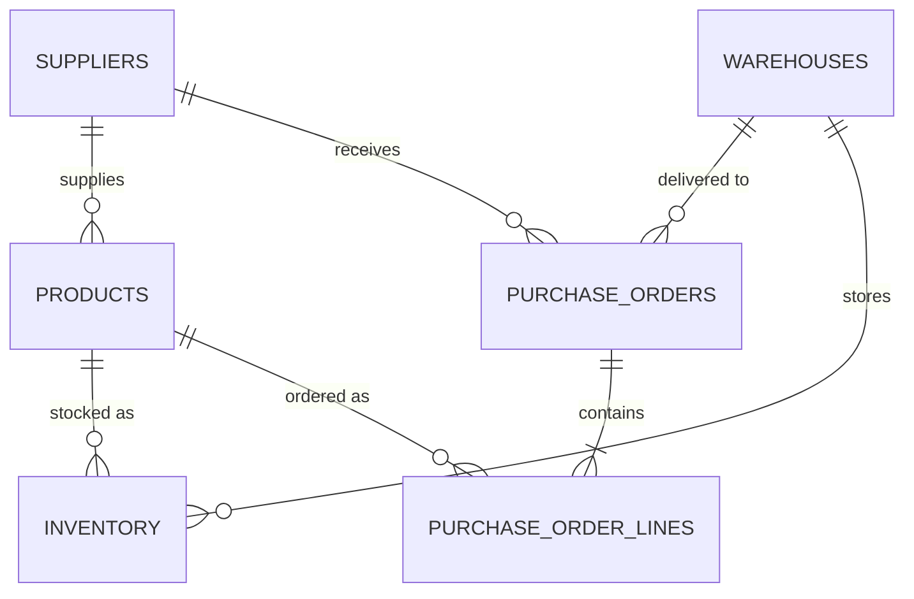

# Inventory & Purchasing Analysis – SQL Basics (MySQL + Power BI)

**Level: SQL basics** · Next step: the intermediate project [supply-chain-sql-analysis](https://github.com/Sohrabrana/supply-chain-sql-analysis) (window functions, CTEs, star schema)

A beginner-friendly SQL project on the inventory and purchasing data of a fictional office-supplies distributor with three German warehouses (Duisburg, Hamburg, Nuremberg) and ten suppliers. It answers 16 everyday questions from the purchasing and warehouse teams. Each query is labelled with the SQL skill it practises, and two views feed a one-page Power BI report.

**Tools:** MySQL 8.0 · SQL (`SELECT`, `WHERE`, `JOIN`, `GROUP BY`, `HAVING`, `CASE`, date functions, subqueries, views, transactions) · Power BI · Python (synthetic data)

> **About the data:** all data is synthetic and generated by [`scripts/generate_data.py`](scripts/generate_data.py) with a fixed seed. Suppliers, products and prices are fictional. One year of purchasing (2025): 982 purchase orders, 3,431 order lines and an inventory snapshot of 180 stock positions on 31 Dec 2025.

---

## Key findings

| Area | Finding |
| --- | --- |
| Stock | **€132.6k** of stock across three warehouses; Duisburg holds the most (€49.6k). |
| Reordering | **19 of 180** stock positions are out of stock or below the reorder point. Refilling them to target stock costs about **€16.7k**. |
| Overstock | 22 positions are above target stock and tie up **€34.2k**, or **26%** of the stock value. |
| Supplier reliability | Only **69%** of purchase orders arrived on time. Delta IT Accessories (94%) and Beta Packaging (90%) are the most reliable; the two furniture suppliers deliver on time **less than half** the time. |
| Biggest supplier risk | **Eta Paper Mills** has the highest spend (€223k) but delivers only **55%** of orders on time, with an average lead time of 10.4 days. |
| Completeness | Fill rates are high: every supplier delivered at least 98% of the ordered units. |

**Recommendation:** start with the reorder list (Q8). Then talk to Eta Paper Mills about delivery dates, or move part of the paper volume to Alpha Paper Supply (80% on time, 5.2 days lead time). Reduce the overstocked items before the next order cycle.

All figures come from [`sql/04_basic_queries.sql`](sql/04_basic_queries.sql); the outputs are saved in [`results/`](results/).

---

## Data model



Tables, keys and constraints: [`sql/01_create_tables.sql`](sql/01_create_tables.sql).

---

## Questions and SQL skills

| # | Question | SQL skill |
| --- | --- | --- |
| Q1 | Packaging products from cheapest to most expensive | `SELECT`, `WHERE`, `ORDER BY` |
| Q2 | 10 most expensive products | `ORDER BY … DESC`, `LIMIT` |
| Q3 | Suppliers per country | `COUNT`, `GROUP BY` |
| Q4 | Paper products costing €5–30 | `LIKE`, `BETWEEN`, `AND` |
| Q5 | Stock value per warehouse | `INNER JOIN`, `SUM`, calculated columns |
| Q6 | Stock value per category, share of total | Subquery for the total |
| Q7 | Stock status of every item | `CASE` |
| Q8 | Reorder list with supplier and order value | Joining 4 tables |
| Q9 | Spend per supplier in 2025 | `COUNT(DISTINCT)`, date range |
| Q10 | Suppliers with more than 90 purchase orders | `HAVING` |
| Q11 | Monthly purchase value | `DATE_FORMAT`, grouping by an expression |
| Q12 | Supplier on-time rate and lead time | `DATEDIFF`, `CASE` inside `AVG` |
| Q13 | Supplier fill rate | `NULLIF` against division by zero |
| Q14 | Open purchase orders per supplier, including zero | `LEFT JOIN`, filter in `ON`, `COUNT(column)` |
| Q15 | Overdue open purchase orders | Date comparison, `DATEDIFF` |
| Q16 | Products above their category's average cost | Correlated subquery |

[`sql/03_insert_update_delete.sql`](sql/03_insert_update_delete.sql) shows `INSERT`, `UPDATE` and `DELETE` inside a transaction that is rolled back, so the data stays unchanged.

---

## How to run

Requirements: MySQL 8.0 with the `mysql` command-line client; Python 3 for the optional scripts.

```bash
git clone https://github.com/Sohrabrana/inventory-management-sql-basics.git
cd inventory-management-sql-basics

mysql -u root -p -e "SET GLOBAL local_infile = 1;"     # once: allow loading local CSV files
mysql --local-infile=1 -u root -p < sql/00_run_all.sql

python3 scripts/export_results.py -u root   # optional: refresh results/*.csv
python3 scripts/generate_data.py            # optional: regenerate data/*.csv
```

**MySQL Workbench:** run the files in `sql/` in order 01 → 05. To load the data, use the *Table Data Import Wizard* for each CSV in `data/`, or enable `OPT_LOCAL_INFILE=1` under *Connection → Advanced → Others*.

## Power BI

[`sql/05_views_for_power_bi.sql`](sql/05_views_for_power_bi.sql) creates `vw_inventory_status` and `vw_purchase_orders`. [`powerbi/report_guide.md`](powerbi/report_guide.md) describes the connection, a shared warehouse filter, 8 DAX measures and the layout of a one-page Inventory & Supplier Overview.

## Repository structure

```
├── data/        CSV source data (synthetic)
├── sql/
│   ├── 00_run_all.sql               runs everything in order
│   ├── 01_create_tables.sql         tables, keys, constraints
│   ├── 02_load_data.sql             LOAD DATA from CSV
│   ├── 03_insert_update_delete.sql  data changes in a rolled-back transaction
│   ├── 04_basic_queries.sql         16 business questions
│   └── 05_views_for_power_bi.sql    views for the report
├── powerbi/     report guide and DAX measures
├── scripts/     data generator and results export
└── results/     query outputs as CSV
```

---

**Sohrab Rana** · Junior BI / Data Analyst · [LinkedIn](https://www.linkedin.com/in/sohrab-rana)
